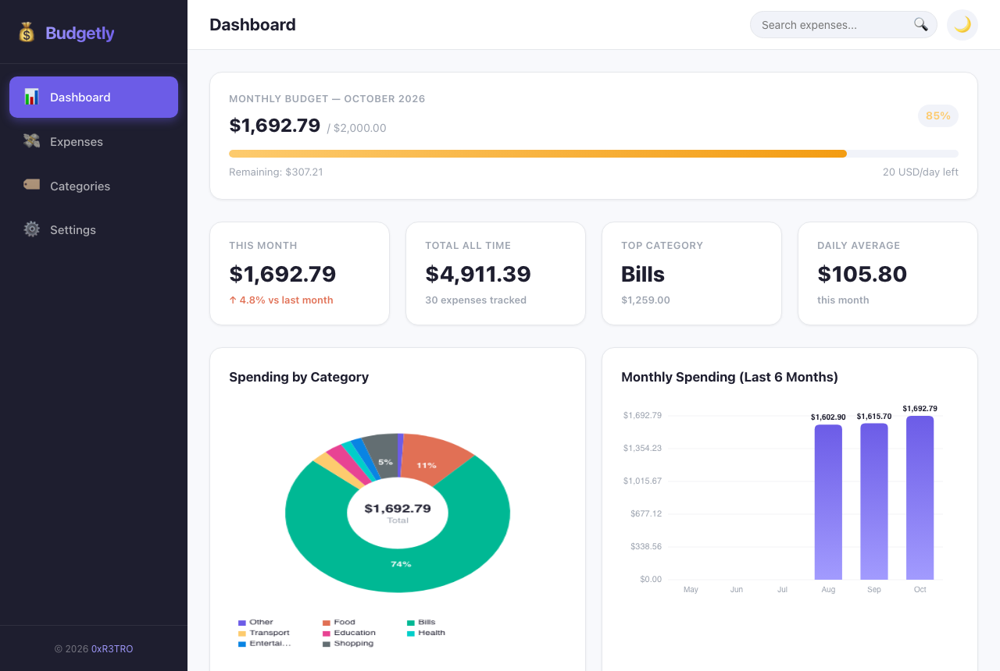
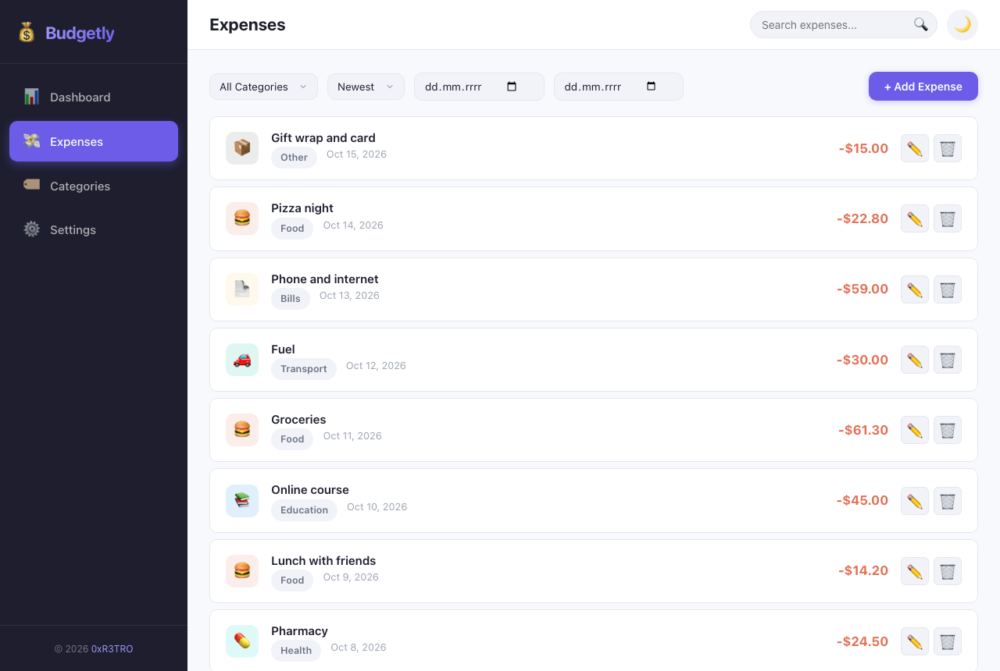
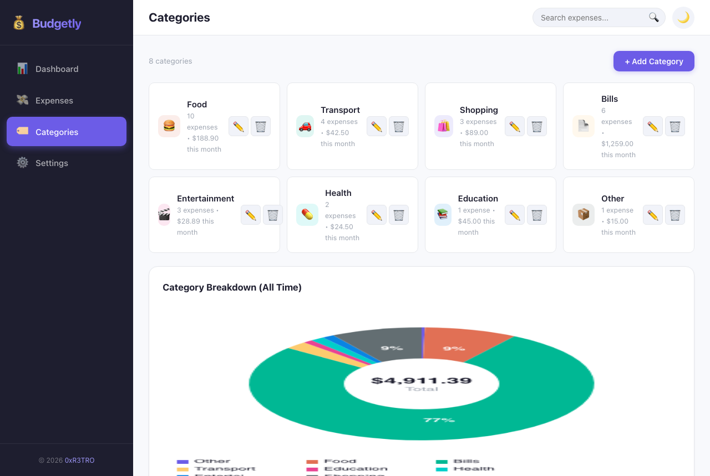
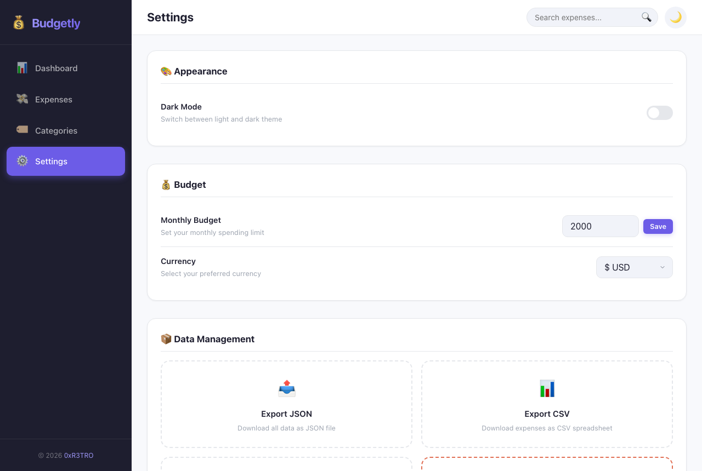

# 💰 Budgetly

Expense tracker that runs entirely in the browser — plain HTML, CSS and JavaScript, no frameworks and no backend. Your data stays on your device in `localStorage`.

**Use it:** https://klefas.me/budgetly/



## Features

### Expenses and budget

- Add, edit and delete expenses with amount, category, date and description
- Default and custom categories; renaming or deleting a category updates its expenses
- Monthly budget with a progress bar and an overspend alert
- Dashboard: this month, all-time total, top category, daily average and change against last month
- Canvas charts: spending by category (donut) and the last six months (bars)
- Search across descriptions, categories, amounts and dates (`Ctrl/Cmd + K`)
- Filter by category and date range; sort by date or amount

### Data

- Autosave in the browser
- Export to JSON (full backup) and CSV (spreadsheet)
- Import from a JSON backup
- Clear all data

### Interface

- Light and dark theme
- Responsive layout for phone, tablet and desktop
- Currency display: USD, EUR, GBP, PLN, JPY or CHF (formatting only, no conversion)

## Screenshots

| Expenses | Categories | Settings |
| --- | --- | --- |
|  |  |  |

Screenshots use sample data.

## Run locally

No build step and no dependencies:

```bash
git clone https://github.com/0xR3TRO/budgetly.git
cd budgetly
```

Then open `index.html` in a browser, or serve the folder with any static server.

## Project structure

```
budgetly/
├── index.html              # App shell
├── styles/styles.css       # Design system and responsive styles
├── screenshots/            # Images for this README
└── scripts/
    ├── app.js              # Entry point
    ├── router.js           # Hash-based routing
    ├── storage.js          # localStorage data layer and statistics
    ├── charts.js           # Canvas charts
    ├── utils.js            # Formatting, validation, IDs
    ├── components/         # Modal, toast, dropdown, tabs
    └── views/              # Dashboard, expenses, categories, settings
```

## Data model

```json
{ "id": "…", "amount": 42.5, "category": "Food", "description": "Lunch", "date": "2026-10-14" }
```

Categories are stored as `{ "id", "name" }`; settings as `{ "theme", "monthlyBudget", "currency" }`.

## Ideas for later

- Offline mode (PWA)
- Recurring expenses
- Income alongside expenses

## License

[MIT](LICENSE) © 2026 0xR3TRO
